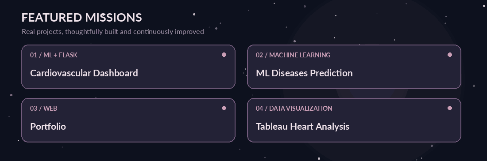

 

**Building thoughtful AI experiences, from reliable Flask backends to practical machine learning.**

---

### ✦ Mission control

I'm **Simmi**, a developer exploring **Python, Flask, machine learning and LLM-powered applications**. I like connecting strong backend fundamentals with clean interfaces and meaningful use cases. This space documents my real work as I learn, build and improve.

> **Currently exploring:** Flask APIs · retrieval-augmented generation · data visualization · ML systems

### ✧ Tech constellation

*Some technologies are part of my active learning roadmap; this is not a claim of expertise in every tool.*

### ✧ Featured missions

| Explore repository | Focus |
|:--|:--|
| [Cardiovascular Disease Dashboard](https://github.com/SIMMI5KUMARI/cardiovascular-disease-dashboard) | Tableau · Flask · Machine learning |
| [ML Diseases Prediction](https://github.com/SIMMI5KUMARI/ML_DISEASES_PREDICTION) | Python · ML |
| [Portfolio](https://github.com/SIMMI5KUMARI/PORTFOLIO) | Web development |
| [Tableau 01](https://github.com/SIMMI5KUMARI/TABLEAU_01) | Heart analysis · Data visualization |

### ✦ Next orbital missions

**On my build roadmap — not completed projects yet:**

`DocuMind AI` — citation-aware PDF question answering with Flask + RAG  
`Astra Research Agent` — source-grounded research with LLM tool calling  
`CodeLens AI` — an explainable code review assistant

### ✧ Contribution constellation

<picture>
<source media="(prefers-color-scheme: dark)" srcset="https://raw.githubusercontent.com/SIMMI5KUMARI/SIMMI5KUMARI/output/github-snake-dark.svg">
<source media="(prefers-color-scheme: light)" srcset="https://raw.githubusercontent.com/SIMMI5KUMARI/SIMMI5KUMARI/output/github-snake.svg">

</picture>

One meaningful commit at a time. ✦

---

**Stay curious. Build thoughtfully. Keep evolving.**  
✦ Somewhere between code and the cosmos ✦

