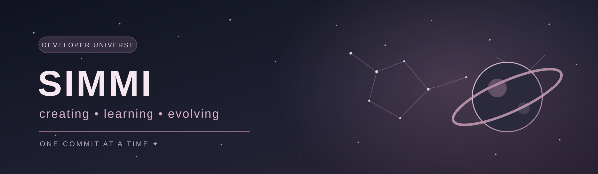

### Hi, I'm Simmi ✦

**Exploring data, machine learning & the web — one project at a time.**

✧ Learning in public &nbsp; · &nbsp; Building with curiosity &nbsp; · &nbsp; Growing with every commit ✧

  
  

---

### ✧ About me

I'm a curious developer exploring the intersection of **data, code and thoughtful design**. I enjoy learning by doing, building practical projects, and improving them step by step. This profile is a growing record of my journey — genuine progress over perfect numbers.

- 🌙 **Exploring:** Python, machine learning, data visualisation and web development
- 🪐 **Currently focused on:** developing stronger foundations and polishing real projects
- ✨ **My approach:** experiment, learn, document and keep building

### ✦ My toolkit

### ✧ Selected work

| Project | Description |
| :--- | :--- |
| **[Cardiovascular Disease Dashboard](https://github.com/SIMMI5KUMARI/cardiovascular-disease-dashboard)** | Heart-disease analysis using Tableau, Flask and machine learning |
| **[ML Diseases Prediction](https://github.com/SIMMI5KUMARI/ML_DISEASES_PREDICTION)** | Exploring disease prediction with machine learning |
| **[Portfolio](https://github.com/SIMMI5KUMARI/PORTFOLIO)** | A personal web portfolio |
| **[Tableau 01](https://github.com/SIMMI5KUMARI/TABLEAU_01)** | Group project exploring heart analysis |
| **[ML Smart Studio](https://github.com/SIMMI5KUMARI/ml_smart_Studio)** | Machine learning project workspace |

My projects reflect what I am learning and will continue to evolve.

### ✦ Contribution constellation

<picture>
  <source media="(prefers-color-scheme: dark)" srcset="https://raw.githubusercontent.com/SIMMI5KUMARI/SIMMI5KUMARI/output/github-snake-dark.svg" />
  <source media="(prefers-color-scheme: light)" srcset="https://raw.githubusercontent.com/SIMMI5KUMARI/SIMMI5KUMARI/output/github-snake.svg" />
  
</picture>

Every little square is a step forward ✦

---

**Stay curious · Build thoughtfully · Keep evolving**

✦ Somewhere between code and the cosmos ✦

