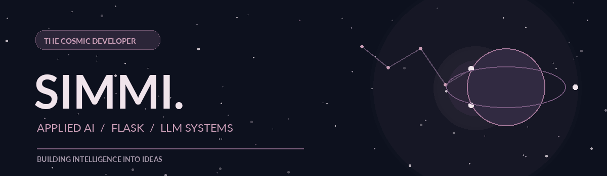
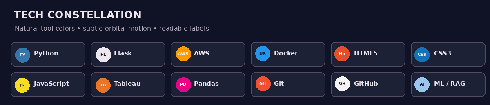
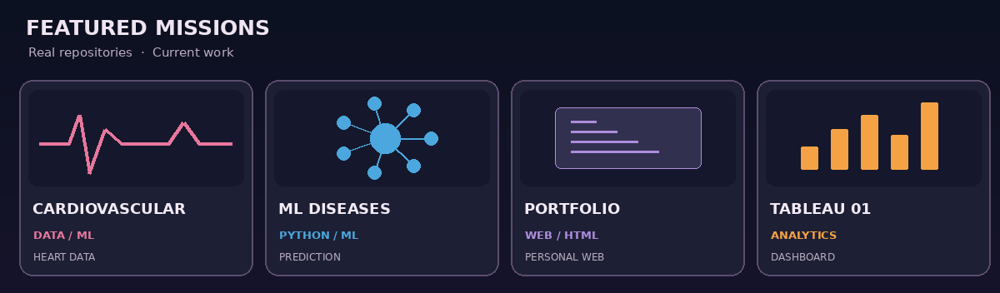
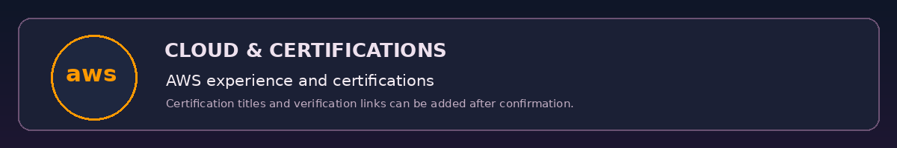
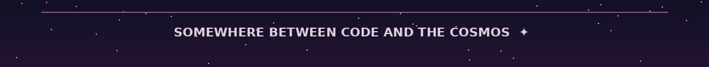

**Applied AI · Flask · LLM Systems · AWS Cloud**

*Turning practical ideas into intelligent applications.*

### ✦ GitHub Insights

Dynamic stats reflect actual public GitHub activity. External image services may occasionally be unavailable.

### ✦ Tech Constellation

<!-- These links display recognizable original brand logos. This section lists skills used in projects or under active study. -->

Currently exploring more: RAG · LLM APIs · Docker · Cloud deployment

### ✦ Featured Missions

| Project | Focus |
|:--|:--|
| [Cardiovascular Disease Dashboard](https://github.com/SIMMI5KUMARI/cardiovascular-disease-dashboard) | Tableau · Flask · ML for heart-related analysis |
| [ML Diseases Prediction](https://github.com/SIMMI5KUMARI/ML_DISEASES_PREDICTION) | Python and machine learning exploration |
| [Portfolio](https://github.com/SIMMI5KUMARI/PORTFOLIO) | Personal web portfolio |
| [Tableau 01](https://github.com/SIMMI5KUMARI/TABLEAU_01) | Heart-analysis data visualization project |
| [ML Smart Studio](https://github.com/SIMMI5KUMARI/ml_smart_Studio) | Machine learning project experiments |

### ✦ Cloud & Certifications

- ☁️ **Amazon Web Services:** learning and working with cloud concepts.
- 🎓 **AWS certified:** exact certificate name and verification link to be added after confirmation.
- 🛠️ **Cloud focus:** deployment, scalability, and secure application design.

### ✦ Next Missions · Planned

> **DocuMind AI** — Flask + RAG document Q&A with page citations  
> **Astra Research Agent** — tool-using LLM research workflow  
> **CodeLens AI** — an AI-assisted code review tool
>
> *These are planned builds, not completed repositories.*

### ✦ Contribution Constellation

<picture>
  <source media="(prefers-color-scheme: dark)" srcset="https://raw.githubusercontent.com/SIMMI5KUMARI/SIMMI5KUMARI/output/github-snake-dark.svg" />
  <source media="(prefers-color-scheme: light)" srcset="https://raw.githubusercontent.com/SIMMI5KUMARI/SIMMI5KUMARI/output/github-snake.svg" />
  
</picture>

A little progress every day, a stronger universe over time.

