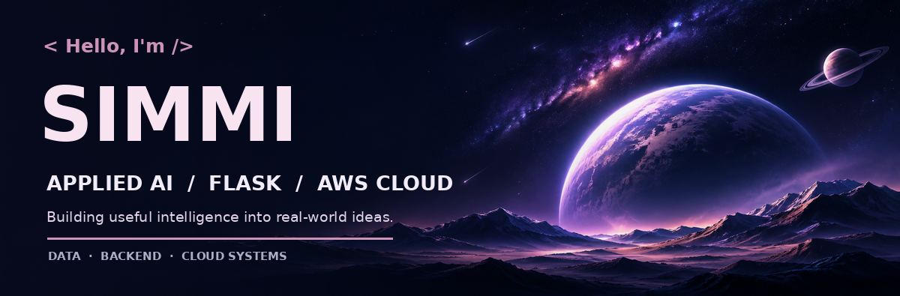
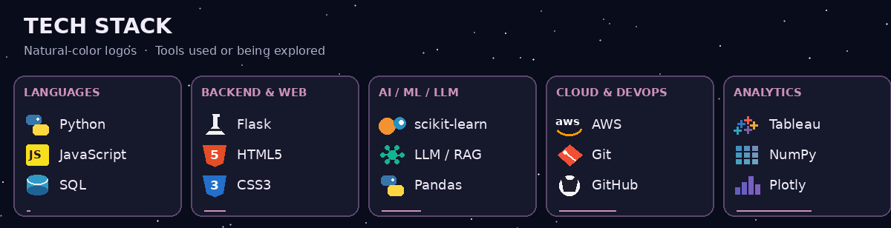
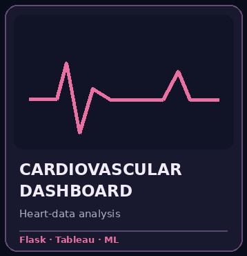
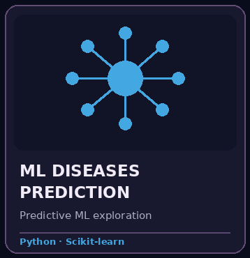
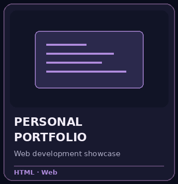
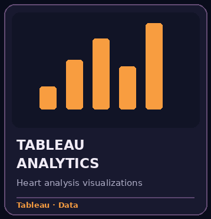
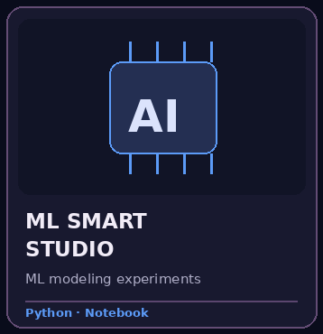
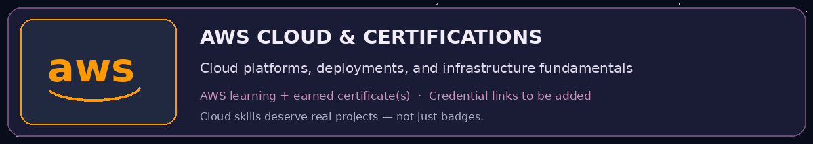
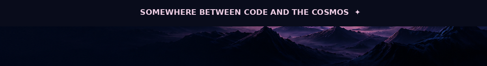

**Applied AI · Flask Development · AWS Cloud · Intelligent Systems**

*Building practical applications where code, data and cloud meet.*

### ✦ GitHub Insights

### ✦ Tech Stack

### ✦ Featured Projects

<table><tr>
<td width="33%"></td>
<td width="33%"></td>
<td width="33%"></td>
</tr><tr>
<td width="33%"></td>
<td width="33%"></td>
<td width="33%" valign="middle"><b>✧ Next missions</b>
DocuMind AI · Flask + RAG Astra · Research Agent CodeLens · AI code review
Planned, not yet completed</td>
</tr></table>

### ✦ AWS Cloud & Certifications

### ✦ Contribution Constellation

<picture>
<source media="(prefers-color-scheme: dark)" srcset="https://raw.githubusercontent.com/SIMMI5KUMARI/SIMMI5KUMARI/output/github-snake-dark.svg" />
<source media="(prefers-color-scheme: light)" srcset="https://raw.githubusercontent.com/SIMMI5KUMARI/SIMMI5KUMARI/output/github-snake.svg" />

</picture>

